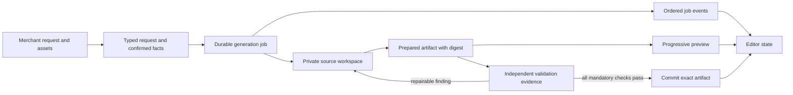

# Yapi architecture diagnosis and recovery plan

Date: 2026-10-01. Status: evidence-backed initial audit. Implementation is in progress; see `2026-10-01-yapi-recovery-implementation.md`. Findings below describe the audited baseline.

## Verdict

Yapi is not ready for dependable merchant use. The evidence supports a substantial replacement of the generation orchestration, verification contract, and editor run-state handling. It does not support deleting the whole product or rewriting commerce, authentication, storage, and checkout.

The primary failure is disagreement between layers about what the request means, which artifact is being checked, and what counts as success. A capable model cannot reliably repair contradictory checks. Adding prompts and retries increases time spent inside those contradictions.

This audit changed no application behavior, merchant revisions, publication, or billing settings. It used code review, existing logs/checkpoints, the browser observation from this conversation, and an offline browser reproduction. No model calls were required for the audit. The working tree already contains substantial ongoing changes; do not reset it or treat all changes as belonging to this audit.

## Findings, ranked by severity

| ID | Severity / confidence | Finding and evidence | Architectural consequence |
|---|---|---|---|
| F1 | High / 1.00 | Style checks compare literal strings against computed CSS. MATCHO's checkpoint has `color: '#146f3d'`, while the checker expects the literal hex spelling. `agent/agent-capture.ts:80`. Offline reproduction returns `rgb(20, 111, 61)` and fails. | An equivalent value can become an impossible repair target. Normalize property values in the browser before comparison; preserve expected and observed values in evidence. |
| F2 | High / 1.00 | The sandbox defaults to reduced motion (`source-visual-capture.ts:11,20`). Agent capture does not override it (`agent/agent-capture.ts:27`). MATCHO hides video under reduced motion, but its plan requires a visible video. Offline reproduction shows video `block` in normal mode and `none` in reduced mode. | Test profiles are implicit and can contradict accessibility requirements. Check normal playback and reduced-motion fallback separately. This reproduction proves the contradiction, not that the complete uploaded video plays successfully. |
| F3 | High / 0.98 | Model-created requirements are frozen after editing (`agent/agent-tools.ts:130`, `agent/agent-task.ts`). They specify low-level selectors and string expectations, but no explicit profile, media-readiness, or semantic color contract. The latest run called `plan_task` four times and repeated the same failed validation three times. The loop then stops (`agent/agent-loop.ts:79`). | The generator is also the author of its gate, without a sufficiently expressive, validated test language. Invalid assertions become production blockers; omitted assertions can miss real intent. Separate merchant requirements from implementation selectors and checker execution. |
| F4 | High / 0.95 | Verification compiles/repairs workspace source, invokes a gate that mutates `generated.files`, then checks a separately prepared workspace preview. Finish invokes the gate again; save prepares the artifact again. `agent/agent-tools.ts:175-212,240`; `source-generation.service.ts:593-680,702-711,937-945`; `source-projects.service.ts:172`. | No single immutable artifact is clearly the unit of preview, evidence, and commit across the entire pipeline. This is a confirmed divergence path; this audit does not claim every repair changes the final appearance. Prepare once per source digest and commit precisely the artifact whose evidence passed. |
| F5 | High / 0.98 | Chat awaits generation in the request; Studio polls separate progress and preview endpoints. The run loop is process-local. Stale-run cleanup marks RUNNING jobs INTERRUPTED after 10 minutes (`source-generation.service.ts:518`), although ChatGPT-plan runs may last 12 minutes plus 30 seconds (`agent-loop.ts:9`, service `:527`). Recovery filters FAILED/PARTIAL/BLOCKED, excluding INTERRUPTED (`service:236-240`). | Lifecycle definitions disagree. A concurrent request after minute 10 could expire a legitimate active job; server interruption has no robust continuation contract. This is a code-demonstrated risk, not an observed concurrent corruption incident. Use durable job IDs, leases/heartbeats, fencing, and explicit resume semantics. |
| F6 | High / 1.00 | The new recovery banner is a separate grid child (`source-studio.ts:593`), but workspace CSS assigns three rows: toolbar, flexible content, footer (`source-workspace-design.css:10`). The observed banner consumes the flexible preview row. Recovery tests assert visibility but not useful dimensions (`tests/source-draft-recovery.spec.ts`). | A local fix broke the surrounding layout contract. The editor needs a defined run-state view with stable toolbar/status/content/footer slots and geometry checks in the embedded dashboard. This is a regression introduced by our earlier recovery work. |
| F7 | High / 0.95 | The ChatGPT bridge maps every thrown exception to `chatgpt_connection_unavailable` and suggests reconnecting (`scripts/chatgpt-plan/transport.mjs:103`). Separate connection checks succeeded after failures. `plan_task` outputs are omitted from persistent diagnostics (`agent-tools.ts:98`), obscuring four planning attempts in MATCHO. | Distinct failures are collapsed into one diagnosis, so “retry/reconnect” is not evidence-based. Preserve safe stage/error codes, HTTP status, timing, and provider request IDs where available. Never log credentials, raw auth responses, or private source by default. The intermittent connection cause remains unknown. |
| F8 | High / 0.98 | Development defaults to agent; other environments default to single (`config/configuration.ts:368`). The evaluator overrides the engine, bypasses chat, and uses an existing snapshot/revision (`scripts/evaluate-yapi-agent.ts:45-57`). Checkpoint persistence is skipped for candidate runs. | Passing a candidate evaluation does not establish that discovery, upload recovery, scratch creation, persistence, and the deployed editor all work. Local and production paths can differ. Choose one primary path and test the exact release configuration end to end. |
| F9 | Medium / 0.90 | Conversation summaries, historical setup, image classifications, execution prose, request-profile inference, design guidance, and model plans all influence intent. Generation extracts the current request from prose markers; generic design recipes can add pressure beyond the request. `source-chat.service.ts:169,314-340,363-430`; `source-generation.service.ts:398-500`; `agent-prompt.ts:7-55`. | Multiple representations of intent can drift. Normalize a typed request once, keep confirmed facts distinct from model suggestions, and enforce latest explicit merchant choices. Cross-merchant memory contamination was not established by this audit. |

## Concrete incident chain: MATCHO

The saved revision is still 1. The latest examined run is `cmupsrexf00074r3cofzzsvcj`, created at 17:17:22 UTC, shown as 206 seconds in the editor. It planned four times, edited files, and verified three times. Its frozen requirements demand a full-screen video, green logo, and visible hero copy. The saved draft source contains the video element and green inline logo style. Its CSS supplies a reduced-motion poster fallback.

The exact failures are consistent with F1 and F2: literal color comparison and hidden video in the forced reduced-motion profile. The agent changed source repeatedly but could not reconcile those conditions. It stopped, recovery retained the draft, and F6 then made the recovery UI largely obscure the preview.

This sequence demonstrates multiple layers failing together. It does not establish that all visual requirements, video decoding, full-screen geometry, or the complete merchant request were otherwise satisfied.

Private evidence stays in ignored `.yapi-evaluation/`: `matcho-audit-checkpoint.json`, `audit-checker-contract.ts`, `audit-checker-contract.json`, prior `sixphoto-report.json`, and development logs. Do not publish merchant source or uploaded media in reports.

## Current lifecycle and proposed lifecycle

Current: chat/discovery → summary and request interpretation → optional template application/design planning → agent or single engine → model-authored assertions → source repairs and compilation → browser checks → more repairs/rechecks → preparation/save → separate editor checks. Live preview, retained preview, run status, and saved revision use different representations and timing.

Proposed:

The source digest, compiled artifact digest, runtime/compiler version, asset manifest, and test profile must accompany evidence. Any material change invalidates that evidence. Deterministic normalization is recorded as an explicit transformation before preparing the artifact, rather than secretly happening again at finish.

## Keep, replace, and investigate

**Keep behind clear interfaces:** merchant/store ownership checks; existing uploads and catalogs; protected commerce/cart/checkout/account runtime; transactional revision fencing; offline network restrictions; template assets; from-scratch source authoring; existing regression fixtures. These are reuse candidates, not a claim that the entire commerce system has been audited.

**Replace incrementally:** orchestration inside the large generation/chat services, the model-defined assertion protocol, repeated preparation/repair paths, and Studio's independent busy/generating/liveDraft/saved-view decisions.

**Investigate before replacing:** ChatGPT transport. We have proved insufficient diagnostics and intermittent failure, not that replacing authentication or switching providers is necessary. Keep ChatGPT-plan-only mode and no paid fallback throughout.

Creating from scratch stays a first-class requirement. It starts with an empty authored workspace and trusted commerce runtime, not a hidden designer template. Templates are an optional initial source snapshot. Both then use the same build, preview, validation, recovery, and commit lifecycle. This plan does not reduce Yapi to a fixed set of page blocks.

## Ordered execution plan

| Phase | Concrete work and boundaries | Exit gate |
|---|---|---|
| 0. Preserve and baseline | Inventory the dirty working tree; record versions and feature flags; preserve private failing fixtures and existing revisions. Freeze unrelated Yapi features. Add safe trace records and deterministic replay for plan rejection, compiler, checker, connection, and commit stages. Do not interrupt active merchant jobs during development. | Every known incident has an artifact/trace or an explicit evidence gap. Baseline reports distinguish connection, generation, assertion, persistence, and rendering failures. |
| 1. Replace verification contract | Introduce typed checks for semantic color, text, local image/video assets, navigation, and layout. Declare normal/reduced-motion and viewport profiles. Validate check feasibility before generation. Keep merchant intent immutable, but allow logged selector/checker corrections that do not weaken intent. Report observed values and checker errors separately from draft failures. | Correct and deliberately incorrect fixtures are distinguished for each checker; MATCHO color and motion contradictions are reproduced and eliminated without dropping either merchant requirement or accessibility support. |
| 2. Unify artifact preparation | Create a pure preparation service returning artifact, digest, asset manifest, and transformation receipt. Preview and acceptance consume that artifact; commit accepts its verified digest. Remove duplicate hidden repair/compile ownership from gate/finish/save after parity is demonstrated. | Integration tests prove previewed, verified, and saved bytes match; mutations invalidate evidence; stale revisions cannot commit; replaying preparation is deterministic for pinned inputs. |
| 3. Replace run orchestration | Extract a durable job service with request idempotency, one writer per store, heartbeat lease, checkpoint sequence, cancellation, and fenced commit. Separate HTTP submission from job lifetime. Provide typed outcomes: needs-input, building, validating, ready, interrupted, blocked, failed, cancelled. Classify retryable transport errors; cap repairs by real progress and stop impossible-check loops. | Reload, disconnect, process restart, duplicate submission, stale worker, and concurrent edit tests preserve work and do not double-commit. Valid long-running jobs cannot be expired by the 10-minute rule. |
| 4. Rebuild editor run state | Drive the editor from durable job events and explicit states. Keep stable preview/status slots. Display the most recent renderable artifact while source evolves; failure leaves it inspectable. Reconnect by job ID and event sequence. Explain actionable failures without duplicate generic banners. | Embedded and standalone browser tests at desktop/mobile verify usable preview height, first render, incremental updates, failure, reload, resume, and saved/draft switching. All publish/export controls reflect artifact readiness. |
| 5. Consolidate entry paths | Route small edits, template adaptation, and genuine scratch creation through the same job API. Keep typed confirmed facts and upload provenance. Pin the primary engine in release configuration; retain legacy only for explicit, temporary rollback. | A small logo edit, uploaded video cover, six-photo request, template adaptation, and scratch store complete from actual UI submission through revision save and reload. A scratch run never calls template application. |
| 6. Release gate and retirement | Run a documented repeated live acceptance suite using ChatGPT-plan mode after deterministic suites pass. Record failures, latency, first-render time, calls, and actual artifact fidelity. Roll out by store/feature flag; preserve rollback and revision history. Remove legacy orchestration only after parity and sustained results. | See release criteria below. A unit-test count or one successful model response cannot satisfy this gate. |

Dependencies: phase 0 precedes all replacements; phase 1 defines evidence consumed by phase 2; phases 2–3 establish the contract for phase 4; phase 5 unifies entry paths; phase 6 decides readiness. Do not rewrite the shared commerce runtime in these phases. Migrate one ownership boundary at a time; never let old and new workers mutate the same job.

## Release criteria and evaluation matrix

Proposed minimum gate, to be made executable before declaring readiness:

- Zero false-completion, unintended publication, lost saved revisions, cross-store asset access, duplicate commit, or paid-provider fallback in the deterministic and live suites.
- All checker negative cases fail for the correct reason, while semantic equivalence and accessibility fallback positive cases pass.
- Five core flows (logo color, video hero, six uploaded photos, template adaptation, genuine scratch creation), each run three times through the real chat/job/editor path: all 15 complete, preserve confirmed facts, and remain correct after reload. Count every failure; do not replace failed runs with cherry-picked successes. Connection failures remain part of user-visible reliability, while also reported separately for attribution.
- At least one empty and one populated catalog represented; desktop and mobile checked for every core flow. Scratch scenarios include confirmed text/assets and absence of invented products/prices/policies. Offline purchase probes are distinct from real payment integration tests.
- Fault-injection scenarios: provider refusal, dropped stream, timeout, invalid check, failed compilation, duplicate submission, browser reload, worker restart, lease expiry, and revision conflict. Each has a defined recoverable or terminal result.
- Report median/tail total latency and time to first render. Preview delivery target: within two seconds after a renderable artifact becomes available, measured separately from model response and compilation time. Establish realistic total-generation targets from the baseline rather than inventing promises now.
- If live allowance or connectivity prevents testing, report the gate as blocked/incomplete. Do not enable paid fallback or call Yapi ready.

These are release gates, not a statistical claim of universal reliability. Broaden models and templates only after the primary supported configuration passes.

## Coverage of the 12 audit layers

| Layer | Conclusion |
|---|---|
| System prompt | Multiple contracts and generic recipes; consolidation proposed (F9). |
| Session history | Last 100 source messages plus setup metadata influence interpretation; provenance needs typing (F9). |
| Long-term memory | No cross-merchant contamination established; not used as an explanation. |
| Distillation | Model summaries persist in setup and affect later requests; factual drift risk, not a proven independent incident. |
| Active recall | Summary, current request, source, capability index and guidance overlap; exact prompt-size contribution still unmeasured. |
| Tool selection | Required planning/finish gates exist in code; inability to skip them is good. Check expressiveness is inadequate (F3). |
| Tool execution | Atomic batch edits and protected paths are reusable. Plan errors are insufficiently observable (F7). |
| Tool interpretation | Literal CSS and implicit motion profile produce demonstrated false negatives (F1–F2). |
| Answer shaping | Generic merchant failures conceal actionable categories; separate outcome schema proposed. |
| Platform rendering | Recovery banner grid regression observed and explained (F6). |
| Hidden repairs | Multiple mechanical repairs/preparation paths with unclear artifact identity (F4). |
| Persistence | Transactional fencing exists; process-local orchestration, timeout and recovery state mismatches remain (F5). |

## Open questions and limits

We have not measured a population-wide success rate, fully audited customer checkout/security, established the intermittent transport cause, or run an end-to-end live scratch build in this audit. The minimal checker reproduction does not test actual video codec support or full-viewport composition. Existing background design jobs have leases and request uniqueness (`StoreSourceDesignJob`); evaluate reusing that infrastructure before introducing a new job subsystem. Preserve the separate distinction between an authored draft, a prepared preview, a verified saved revision, and publication.

Recommendation: proceed with phase 0 and phase 1 as the first implementation milestone, then replace the artifact/job boundaries. Do not resume feature expansion or ask the merchant to repeatedly retry as the testing strategy.
