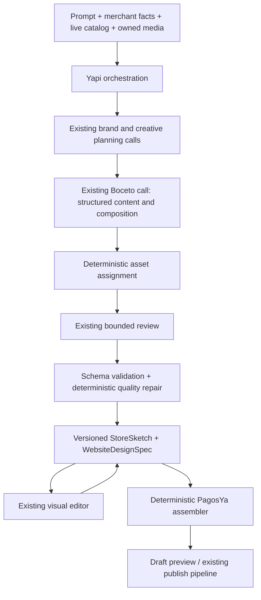

# Yapi design engine

## Repository audit and implementation plan

PagosYa is a pnpm TypeScript monorepo. Merchant Studio uses Vite and native DOM controls. The API uses NestJS, Prisma/PostgreSQL, Zod, Responses providers, generation budgets, persisted jobs and AI usage receipts. Storefront source projects compile React into previews with esbuild and export a platform-scaffolded Next.js project. The commerce runtime and `@pagosya/ui` own catalog, cart, checkout, product and account behavior.

The existing editable intermediate representation is `sketch.json`: palette, local font ids, shared styles, product/account configuration and typed blocks. `repairSketch` normalizes persisted documents; `assembleSketch` renders both preview and production sources. Studio selects and edits blocks, nested groups, copy, media, order, spacing and free positions. Building removes the phase marker `sketch.json`; older revisions retain the boceto. SourceProject snapshots already provide optimistic concurrency, version history, recovery, draft/published separation and ownership checks. No new database tables are required.

Products are PaymentLink rows with integer minor-unit prices, categories, photos, variants, stock and merchant descriptions. Categories and collections are separate store-scoped entities. Uploads use MediaAsset with ownership checks, derivatives and asset roles. Generation bundles uploaded/catalog photos and locally licensed fonts. Existing responsive CSS and isolated browser checks can be extended.

Before this design-engine work, fresh generation drew visual attributes and a constrained page skeleton using Math.random, asked one model to fill copy/style, and used another composition pass to position parts. It lacked persisted brand reasoning, reproducible seeds, a shared composition registry, complete site tokens and design-wide quality feedback. The existing source agent remains useful for established sites and code editing.

Implementation order:
1. Add shared design metadata and extensible composition registry, using existing block types.
2. Add Zod schemas, seeded brand-aware defaults, separate brand and creative planning prompts.
3. Integrate budgeted/metered stages ahead of existing sketch filling and registered composition rendering.
4. Persist design spec, tokens, assignments and quality results within versioned bocetos; retain a production design artifact after building.
5. Render variants and tokens through the existing assembler, with mobile/tablet rules and accessible commerce.
6. Expose composition and image treatment in the existing inspector and regeneration through the current Yapi chat.
7. Add deterministic coffee, botanical and premium home fixtures, focused tests and browser captures using existing tooling.

Reference research: https://dhoopmag.com/ (editorial content and commerce), https://bouquetinfusions.com/ (botanical product storytelling), https://littleampscoffee.com/ (coffee, records and merchandise). These are inspiration only; no reference code, copy or assets are included.

## Implemented architecture



These stages are the existing bounded structured model calls. The component-registry work adds no agent framework or extra orchestration stages. They cannot run tools or create arbitrary frontend code. Rendering, responsive geometry, saving, product queries, pricing, checkout and publishing remain ordinary software. The pre-existing source coding agent still handles established source sites and explicit compatibility paths.

### Generation flow

1. Load authorized merchant data and store-scoped products/categories. Bundle owned uploads and catalog images with the existing media allowlist. Reference images remain design evidence, never merchant assets or facts.
2. **Brand analysis call:** infer business, positioning, audience, personality, visual vocabulary, tone and conversion goals from actual merchant context, catalog summaries and supplied images.
3. **Creative planning call:** choose one coherent art direction, palette, local fonts, scale, navigation and section intents/compositions from the registry.
4. **Boceto call:** normalize the plan into existing `PageStructure` slots, fill the typed `StoreSketch` content, choose registered compositions and let the deterministic renderer position their content. The former automatic free-element pass is excluded from default generation: it could place copy across section boundaries. No React/HTML/CSS is requested.
5. Assign allowed images by role and preserve valid model image choices. Prefer lifestyle media for immersive layouts and contained product imagery for product-focused directions. Spend unused assets before repeating them. One image is sufficient for a hero; unavailable gallery slots are removed.
6. **Critic call:** review once, returning at most three layout patches. Patches can change registered composition, width, alignment and scale. They cannot change copy, prices, product bindings, assets, policies or claims. Unknown ids/incompatible variants are ignored.
7. Deterministically repair empty actions, impossible immersive heroes and empty galleries; record heuristic scores/findings. Repair palette contrast through the existing sketch normalizer, select legible section ink, preserve safe font ids and constrain geometry.
8. Compile with the existing assembler and source project preparation. Save a new draft revision with `sketch.json` and `website-design.json`. The existing publishing service is still the only live-site publisher.

Every stage uses the existing provider selection, cancellation signal, budget reservation, settlement, usage metering and generation receipt. Brand/creative stages retry invalid structured responses once; Critic performs one review attempt. Invalid boceto output is rejected before normalization and uses a bounded validated fallback. A provider outage yields a deterministic brand-aware draft; failed attempts remain visible in receipts and are not billed as successful stages.

Prompts are versioned in `design-prompts.ts` and `design-critic.ts`; existing `sketch-request.ts` owns the detailed block/content format. The legacy `sketch-composition.ts` utility remains available for explicit free-composition work, outside normal generation. Content guidelines prohibit invented certifications, ingredients, processes, sustainability, shipping promises, metrics and testimonials. Testimonials are excluded until actual quote content has a supported binding. Newsletter sections are only planned when the store's existing retention signup is enabled.

## Schemas and persistence

`packages/shared-types/src/sketch-registry.ts` owns the shared composition vocabulary; `website-design.ts` owns design metadata. API Zod schemas live in `design-schemas.ts`, `design-document.ts` and `design-critic.ts`. `structured-output.ts` validates the existing provider JSON schemas locally before `repairSketch` runs.

The editable `StoreSketch` remains authoritative:

```ts
// Existing palette, fonts, style, product/account skins and typed blocks remain intact.
StoreSketch.design?: WebsiteDesignSpec
StoreSketch.dna?: SourceDesignDna // canonical source-dna.ts, normalized with normalizeDna
SketchLayout.composition?: string
Hero.photos?: string[] // extra owned media, primary image remains Hero.photo
SketchLayout.imageFit?: 'cover' | 'contain'
SketchLayout.focalPoint?: { x: number; y: number } // 0–100 percent
SketchLayout.productRefs?: string[]
```

`WebsiteDesignSpec` contains schema/prompt versions, seed, brand direction, art direction, full theme tokens, projected pages, navigation/footer, image assignments, responsive constraints, quality results and generation metadata. `syncDesignSpec` rebuilds content, asset references and mutable tokens after every edit. Two competing copies of editable content do not develop independently. Invalid metadata is discarded safely on legacy reads.

Home sections project the actual boceto. Product and checkout page descriptors point to platform-owned commerce pages; their empty section lists do not mean those pages are missing. They continue to use the existing product/account skins and checkout components, rather than being redesigned by a creative agent. Their current routes are controlled by the source commerce router.

No database migration or new table is needed. SourceProject snapshots and StoreSourceVersion revisions already store these JSON files, enforce merchant ownership and optimistic concurrency, preserve the previous boceto and separate drafts from the published revision. Building a site removes the `sketch.json` phase marker, retains one `website-design.json` artifact and preserves the preceding boceto in revision history. Return to a previous revision to resume its boceto; later source editing remains the existing workflow.

## Tokens and rendering

The design-token layer extends existing palette/font/style primitives. Colors, display/heading/body scale, tracking, line height, section/gutter spacing, widths, card/button radius, shadow choice, button and image treatments have typed values. Numeric values are bounded and finite; font ids resolve through the existing local font catalog.

`design-css.ts` emits `--yapi-*` variables alongside existing `--skb-*` palette/font variables. Components inherit them. Registered variants define geometry through `data-skb-composition`; no AI-authored CSS is inserted. Composition styles opt in through `data-yapi-design`, so older manual sites and bocetos keep their existing rendering. A merchant choosing a new composition on a legacy boceto gets its geometry and bounded token defaults, without opting the rest of the page into the new global art direction.

The assembler creates normal production components and CSS from the same boceto the editor displays. Media uses bundled optimized assets, crop/focal metadata, alt text, eager hero decoding and lazy secondary images. Demo assets are resized and converted with the already-installed Sharp; production uploads keep the existing derivatives/bundling system. The existing live commerce runtime supplies current price, compare-at price, descriptions, stock, variants, badges, cart and payments. The creative plan can name owned catalog ids in `productRefs`; unknown ids are discarded. These references prioritize selected products within the live catalog; they do not freeze prices or hide the rest of the merchant's catalog.

### Registry

`packages/shared-types/src/sketch-registry.ts` is the shared source of truth. It contains **68 entries**, including **28 principal art-directed compositions** and compatibility compositions for older sketches. Definitions contain `id`, family/type, variant, Spanish editor label, purpose, fixed renderer id, optional legacy variant, styles/verticals, image/commerce requirements, density compatibility, default width, mobile rules and capabilities.

`SECTION_COMPOSITIONS`, provider JSON enums, Zod refinements, Yapi metadata, quality eligibility and Studio options derive from these entries. `source-composition-registry.ts` re-exports this registry and retains its existing vertical direction candidates and eligibility scoring. It does not maintain a second list of variants or editor labels.

| Family | Principal compositions | Shared primitives |
| --- | --- | --- |
| Hero | editorial-split, full-bleed, poster, massive-type, floating-media, product-stage, asymmetric-collage, magazine-cover | Hero, FloatingMedia |
| Catalog | editorial-index, oversized-two-up, horizontal-rail, product-spotlight, asymmetric-grid, lookbook; standard grid retained | Catalog, ProductRail |
| Story | manifesto, editorial-split, chapters, oversized-quote | Statement, FeatureSplit, StoryChapters |
| Media | mosaic, asymmetric-collage, full-bleed, horizontal-strip | Gallery |
| Categories | editorial-index, large-type-links, image-categories | Existing editable category links |
| Footer | giant-wordmark, editorial-columns, minimal | Existing editable navigation/footer markup |

The API's `sketch/sketch-registry.ts` routes fixed renderer ids into deterministic adapters. Content keeps the `data-skb-*` field/group/node markers and ordering used by Boceto. The adapters reuse actual `@pagosya/ui` components, not just their names. `StoreStyles` installs the same UI stylesheet/tokens without introducing another smooth-scroll controller. Catalog presentations use one platform-owned product template and mount: purchasing, inventory, options, names, prices and media hydration stay in `commerce.js`.

Variants change media/copy order and dominance, large type, overlap, numbered index rows, live-product scale, vertical/horizontal browsing and unequal grids. For example, the index puts the name before photography, the rail uses large scrollable media, and spotlight gives the first product a full-width spread. One standard card/grid remains available.

`design-css.ts` emits bounded tokens; `sketch-registry-css.ts` adjusts geometry around shared primitives. Desktop overlap/rotation/stagger has explicit mobile fallbacks. Rules are scoped to registered adapters with sufficient specificity against the shared UI stylesheet. Older sketches without `composition` keep the original `skb-*` renderer and stylesheet. Legacy hero orientation choices are described in the registry so Studio can display them correctly.

### Canonical DNA and media roles

`StoreSketch.dna` uses `SourceDesignDna`, `SOURCE_DNA_SCHEMA`, `normalizeDna` and `dnaRuntimeConfig` from `source-dna.ts`. Creative planning can return that schema; deterministic fallback derives the same canonical DNA. Grammar/density guide composition and spacing, typography remains synchronized with editable font ids, and frame/button/motion/catalog decisions feed existing kit behavior. Registered media frames consume existing `--kit-photo-*` variables. No second DNA vocabulary or database table is introduced.

`sketch-assets.ts` derives design roles from confirmed asset metadata and descriptions: hero-lifestyle, product, product-detail, brand-editorial, location, portrait, decorative and logo. Confirmed shot facts distinguish product packshots from scenes, in-use images and details; explicit product/packaging roles win over descriptive guesses. The existing photo-facts pipeline supplies that evidence before planning. Assignments preserve alt/crop/focal metadata; product stages contain packshots, immersive heroes require scenes, and typographic sections do not consume photographs. Floating/collage heroes initially use two photographs, leaving media for later sections. Secondary hero images are selectable/reorderable through the existing node tree. No image-recognition claims are made when only descriptions are available.

New generation applies the registry's default widths after legacy skeleton repair, so a full-bleed composition stays full bleed. The validator checks actual image slots against registry requirements and repairs insufficient-media compositions. Merchant edits remain authoritative; reporting quality does not rewrite them. Canonical button forms map to the existing Botones controls, and changing that control updates DNA on normalization. Commerce page/cart/review formats retain the existing product recipe.

The prompt favors 5–8 useful sections and removes required announcement/marquee/split/giant-footer and saturated-background checklists. Actual merchant facts and live catalog pricing remain mandatory constraints.

### Add a composition within a family

1. Add one definition in the shared registry, including label, purpose, fixed renderer id and meaningful prerequisites.
2. Extend the trusted family adapter or the appropriate shared UI primitive when genuinely new geometry is needed. Merchant JSON never contains executable code.
3. Add token-based geometry and deliberate mobile behavior in the shared primitive or scoped registry CSS.
4. Keep existing editor field/node/group contracts, one live catalog mount and platform commerce hooks.
5. Add a deterministic fixture, JSX/production-validator assertions and desktop/mobile captures. Schema enums, prompt metadata and editor choices update from the registry.

### Add a section family

Extend the existing `SketchBlock` discriminated union, normalizer and JSON schema, shared sketch node tree/editor controls, block generator and registry. Extend the persisted projection schema and substance constraints. The registry scales composition vocabulary; a new family still requires normal software implementation and responsive/commerce validation.

### Add a creative style

Add a style enum in shared types and `artDirectionSchema`/provider schema. Define coherent default palette/fonts/geometry in `fallbackCreative`, update prompt vocabulary and add grounded example inputs. Model-selected styles already include editorial, minimal, bold-commerce, playful, luxury, organic, retro, industrial, experimental and lifestyle. Deterministic vertical defaults currently demonstrate editorial coffee, playful botanical products and minimal premium home; expand these defaults independently of section renderers.

## Editing and regeneration

Studio opens structured drafts in the usual Yapi chat + preview. **Editar en Boceto** toggles optional manual editing. Yapi always stays in the left column, with the same chat and composer; section layers and properties share the right inspector. Toggling editing off flushes pending edits and reloads the saved revision before returning to normal preview. Failed saves keep the canvas open. Yapi requests from the canvas also flush edits before submitting their revision. Building remains available from either view, and publishing/code edits remain behind the existing build transition.

Studio shows the creative-direction summary. The existing inspector can choose section composition, background, size, width, alignment, imagery/fit, typography, card treatment and which live products to prioritize. Existing selection, reorder, delete, duplicate, text editing and nested/free editing remain available. Double-click copy to edit it in place; use the image picker for photos. **Restablecer disposición** returns displaced copy/photos to their registered flow for a selected section or the whole draft, preserving text, assets, products and inserted elements. Changing composition clears old free positions so they cannot override the new layout. Both actions use existing autosave and undo. Yapi chat continues editing the authoritative boceto and carries layout/image/product fields across content responses.

`POST /stores/:storeId/source-project/sketch/regenerate` accepts the current `revision`, optional `designSeed` and optional `sectionId`. It uses existing authentication, rate limiting and compile-budget controls, checks ownership/revision/section and saves through the normal optimistic revision path. Studio flushes unsaved edits first. Section regeneration changes only that section's layout; whole regeneration varies compositions/order while retaining every merchant content field and binding. It is deterministic normal code, incurs no model call and never publishes automatically. A new seed is chosen when omitted.

The same persisted boceto always renders deterministically. Seeded defaults and model-free regeneration reproduce their input/seed exactly. Fresh AI creative calls can still differ across provider/model revisions; the seed is not a provider determinism guarantee. Store and restore the saved revision for exact replay. Requests such as “more minimal” or “more playful” can continue through Yapi chat; major creative redesign runs the full pipeline and creates a new revision.

## Quality and observability

Scores cover hierarchy, consistency, brand fit, image use, content completeness, variety, ecommerce clarity, mobile safety, accessibility and rhythm. These are bounded structural heuristics, not a visual certification or an automated factual verifier. Findings include duplicate headings, missing/empty actions, repeated backgrounds/layouts/images, unavailable immersive imagery, empty galleries, uniform widths and excessive centered composition. Merchant edits receive report-only validation so deliberate choices are preserved.

Generation logs use stage events (`brand_analysis_started/completed`, `art_direction_started/completed`, `page_structure_generated`, `design_critique_started/completed`, `design_stage_fallback`, `assets_assigned`, `design_validated`, `design_rendered`, `generation_failed`) and generation ids/counts. Receipts record timings, models, usage, status and fallback reasons. No full prompts, private catalog payloads, images or secrets are written by the new stage logs.

Debug in this order:

1. Inspect the draft's `sketch.json`, `website-design.json` and generation receipt.
2. Check brand/creative/sketch/critic attempt status and schema/fallback reason.
3. Confirm allowed media paths and assignments; reference/unused photos cannot become storefront assets.
4. Confirm registered family/variant, finite tokens and product ids.
5. Rebuild with the production assembler and inspect prepared preview/commerce configuration.
6. Use the existing browser capture sandbox for layout/runtime errors; do not equate a structural critic with browser verification.

## Demos and verification

```sh
pnpm --filter @pagosya/shared-types build
pnpm --filter @pagosya/api exec tsc --noEmit
pnpm --filter @pagosya/merchant-studio exec tsc --noEmit
pnpm --filter @pagosya/api exec jest --runInBand --testPathPattern='design-engine|design-critic|sketch-request|sketch-assembler|sketch-studio.service'
pnpm --filter @pagosya/api exec jest --runInBand --testPathPattern=source-generation-agent --testNamePattern='sketch-first design orchestration|chat-on-sketch edits'
pnpm --filter @pagosya/api exec ts-node scripts/generate-design-demos.ts --capture --after-hours
pnpm --filter @pagosya/api exec ts-node scripts/generate-design-demos.ts --capture --variants
node examples/yapi-design-engine/server.mjs
```

`examples/yapi-design-engine` serves the production renderer on http://127.0.0.1:4336. `--after-hours` builds three directions from the **same merchant facts, product records, prices and imagery**:

- `/after-hours-magazine/`: magazine cover, product rail, manifesto, mosaic, category index, giant wordmark.
- `/after-hours-records/`: type poster, giant category links, numbered product index, photo strip, oversized quote, editorial footer.
- `/after-hours-cafe/`: editorial split, full-bleed photo, product spotlight, image/story split, image categories, minimal footer.

These are deterministic authored capability fixtures, not evidence of paid model aesthetic accuracy. Input records/plans live in `design-fixtures.ts`; all photos are existing repository demonstration assets. The record product intentionally has no photograph rather than reusing a breakfast image as a fictional record. No reference-site assets/code/copy are included.

`--variants` builds all 28 principal adapters under `/variants/`. Generated JSON, compiled sites, screenshots at 1440/820/390 and geometry/commerce evidence live in ignored `dist/`. The browser checks overflow, loaded media, one h1, real product-card hydration, keyboard mobile navigation, add-to-cart, quantity increase/decrease and runtime errors. Silhouette evidence records numeric section/image geometry, not color, font or variant names. Existing source validation and Next export tests check the same library in production. These are capture/geometry checks, not reviewed pixel-diff baselines. No new testing framework or paid AI call is introduced.

Without flags the script retains the earlier three-brand coffee, botanical and home fixtures. `design-engine.visual.spec.ts` exercises both that set and AFTER HOURS; `sketch-registry.spec.ts` compiles every principal adapter and checks markers, hostile copy, free positions, DNA and production validation/export.

Schema/unit tests cover invalid provider output, seeded diversity/replay, legacy compatibility, metadata synchronization, editor-field preservation, factual section constraints, bounded critic patches, regeneration, stale drafts and preservation of the production design artifact. Provider integration tests use mocked Responses; demos use deterministic defaults and do not spend paid AI credits.

## Next improvements

- Expand visual fixtures across more verticals; add reviewed pixel baselines if existing screenshot infrastructure adopts them.
- Cache accepted creative plans by normalized input hash + seed + prompt/model version for reproducible fresh AI replay.
- Bind genuine published testimonial text and more collection/product-specific modules. Multiple catalog modules require explicit query/filter bindings and unique anchors; the current safe planner allows one section per family.
- Add per-image focal-point editing and richer semantic vision tagging; current metadata supports focal points, roles, crops and merchant descriptions.
- Extend structured composition to authorable collection/about pages, while checkout and commerce contracts stay platform owned.
- Add a separate approved publication visual gate if desired; generation saves drafts through the current system.
